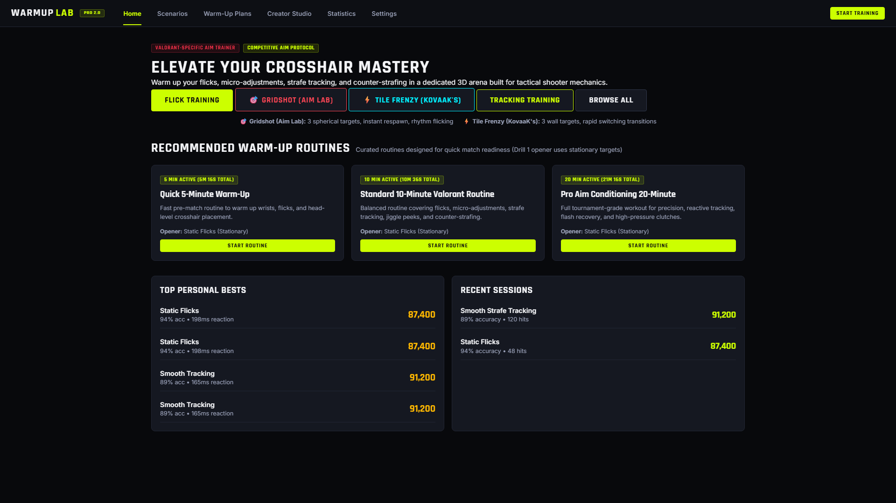
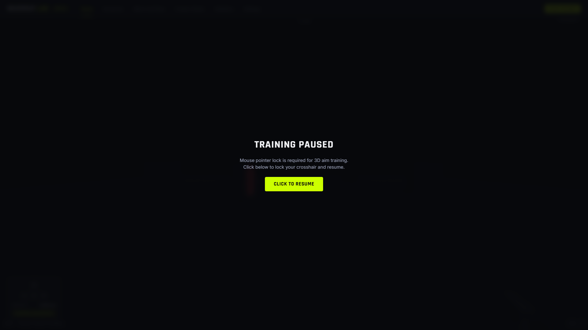
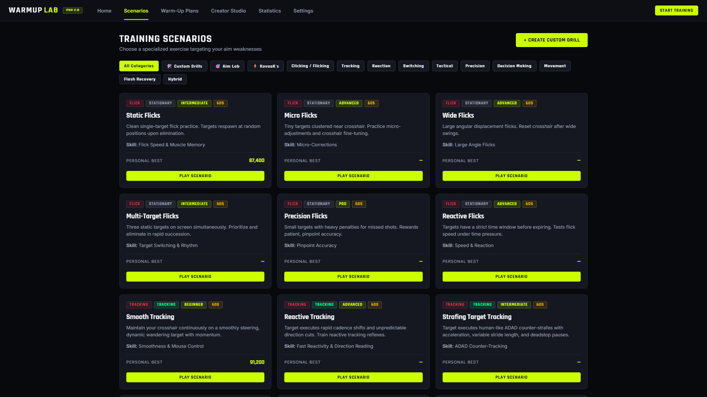
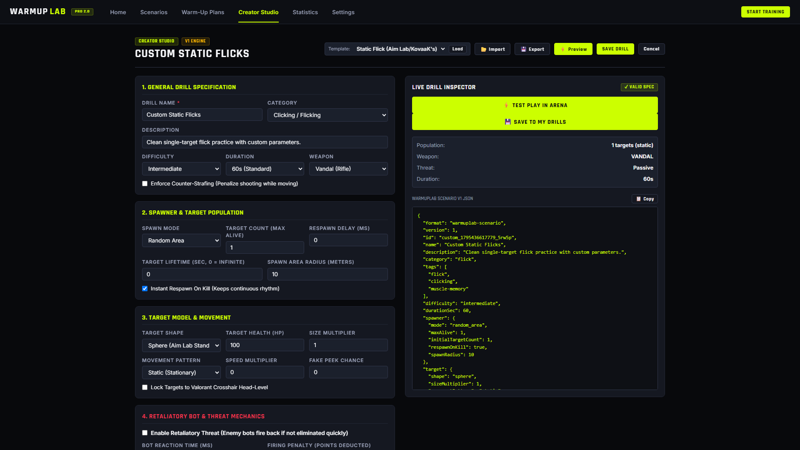
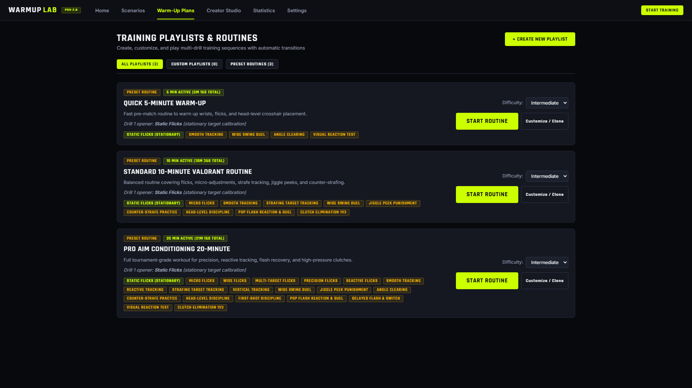
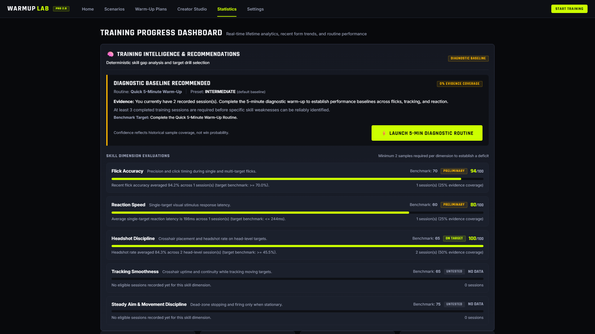
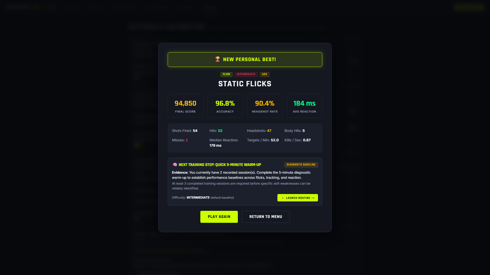
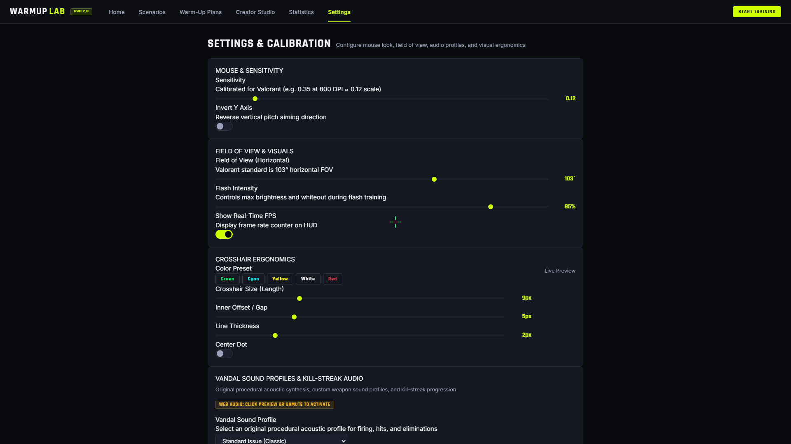

<div align="center">

# WarmupLab
### Competitive FPS Aim Training & Tactical Warmup Platform


<p align="center">
  A lightweight, zero-install 3D tactical FPS aim trainer and warmup suite engineered for competitive shooter mechanics.<br>
  Built with TypeScript, WebGL (Three.js), Web Audio API, and Dexie IndexedDB.
</p>

[**Launch Live App**](https://abdallahmazouz.github.io/Warmup-Lab-Trainer/) &bull; [**Screenshots**](#-screenshots) &bull; [**Core Features**](#-core-features) &bull; [**Scenario Catalog**](#-scenario-catalog) &bull; [**Creator Studio**](#-creator-studio--json-scenario-engine) &bull; [**Architecture**](#-architecture) &bull; [**Getting Started**](#-getting-started) &bull; [**Verification**](#-testing--verification)

</div>

---

## ⚡ Overview

**WarmupLab** is an independent, high-performance browser-based aim trainer tailored specifically to tactical shooter physics. Unlike generic aim trainers, WarmupLab simulates **true first-person movement accuracy**: firing while moving triggers severe velocity-based spread penalties, forcing players to counter-strafe to a dead stop before acquiring headshots.

With **WarmupLab v2.0.0 — Esports Edition**, the platform features a complete visual redesign built on deep obsidian graphite and Electric Lime accents (`#CCFF00`), alongside an extensible **Creator Studio & JSON Scenario Engine**, custom **Playlists & Routine Sequencer**, retaliatory combat bots, and local-first **Dexie IndexedDB** persistence.

---

## 📸 Screenshots

<table width="100%">
  <tr>
    <td width="50%" valign="top">
      <h4 align="center">Command Deck & Live Telemetry</h4>
      <a href="docs/screenshots/01-command-deck.png">
        
      </a>
      <p align="center"><em>Central hub with Quick Warm-Up launch, telemetry summaries, performance ratings, and featured scenarios.</em></p>
    </td>
    <td width="50%" valign="top">
      <h4 align="center">Tactical 3D Training Arena</h4>
      <a href="docs/screenshots/07-tactical-arena.png">
        
      </a>
      <p align="center"><em>Hardware-accelerated WebGL arena with procedural Vandal viewmodel recoil, real-time velocity visualizer, and tactical HUD.</em></p>
    </td>
  </tr>
  <tr>
    <td width="50%" valign="top">
      <h4 align="center">Scenario Browser (39 Built-in Drills)</h4>
      <a href="docs/screenshots/02-scenario-browser.png">
        
      </a>
      <p align="center"><em>Categorized drill catalog spanning Flicks, Tracking, Tactical Duels, Flashes, Reaction, Precision, and Community staples.</em></p>
    </td>
    <td width="50%" valign="top">
      <h4 align="center">Creator Studio Drill Builder</h4>
      <a href="docs/screenshots/03-creator-studio.png">
        
      </a>
      <p align="center"><em>Visual drill designer with starter templates, parameter bounds validation, retaliatory threat options, and live preview.</em></p>
    </td>
  </tr>
  <tr>
    <td width="50%" valign="top">
      <h4 align="center">Custom Playlists & Sequencer</h4>
      <a href="docs/screenshots/04-playlist-sequencer.png">
        
      </a>
      <p align="center"><em>Curated and custom training sequences with automated drill transitions, rest intervals, and missing-drill tolerance.</em></p>
    </td>
    <td width="50%" valign="top">
      <h4 align="center">Telemetry & Performance Trends</h4>
      <a href="docs/screenshots/05-statistics-dashboard.png">
        
      </a>
      <p align="center"><em>Diagnostic evaluation, like-for-like versioned trend graphs, Personal Best records, and historical drill analytics.</em></p>
    </td>
  </tr>
  <tr>
    <td width="50%" valign="top">
      <h4 align="center">Drill Results & PB Celebration</h4>
      <a href="docs/screenshots/06-results-screen.png">
        
      </a>
      <p align="center"><em>Comprehensive post-drill breakdown: headshot ratios, millisecond reaction speeds, accuracy %, and score records.</em></p>
    </td>
    <td width="50%" valign="top">
      <h4 align="center">Settings & Sensitivity Calibration</h4>
      <a href="docs/screenshots/08-settings-calibration.png">
        
      </a>
      <p align="center"><em>Valorant-standard yaw calibration, FOV slider (70°–120°), interactive crosshair customizer, and Web Audio profiles.</em></p>
    </td>
  </tr>
</table>

---

## 🎯 Core Features

### 1. Tactical Ballistics & Counter-Strafing
- **Movement Inaccuracy Dead-Zone**: Bullet spread penalizes shots when moving above $0.6\text{ m/s}$. Clean 1-taps demand decelerating to zero velocity or counter-strafing with opposing keys (`A` $\leftrightarrow$ `D`).
- **Tactical Velocity Visualizer**: Real-time HUD indicator displaying movement states (`A [•] D`) to build stop-before-shooting muscle memory.
- **Procedural Weapons**: 3D Vandal rifle viewmodel with procedural pitch recovery, dynamic weapon sway, muzzle flash, and authentic recoil impulse.
- **Retaliatory Combat Bots**: Target drones that lock onto the player with visual HUD threat meters, firing return damage if not eliminated within a configured reaction window.

### 2. Creator Studio & JSON Scenario Engine
- **Visual Drill Builder**: Fine-tune scenario parameters including spawn bounds ($2\text{m}–40\text{m}$), target counts ($1–20$), movement speeds ($0–4.0\text{ m/s}$), retaliatory delay, and custom scoring formulas.
- **Starter Archetype Templates**: One-click bootstrapping for **Static Flick**, **Dynamic Strafe**, **Peeking Duel**, and **Smooth Tracking** (`tracking_smooth`).
- **In-Arena Live Preview**: Test drill parameters immediately inside the 3D arena without polluting your database.
- **Prototype-Pollution Hardening**: Robust schema validation explicitly rejects `__proto__` and `constructor` injections on import.
- **Configuration Versioning & PB Fairness**:
  - **Save as New Drill**: Clones a scenario into an independent ID with separate PB tracking and history.
  - **Update & Reset PB**: Increments `configVersion` upon material parameter changes, isolating leaderboard scoring from earlier revisions.

### 3. Custom Playlists & Routine Sequencer
- **Custom Playlist Builder**: Create, edit, duplicate, and reorder custom playlists mixing built-in and user-created drills.
- **Accurate Timing & Rest Intervals**: Configurable active drill durations and automated rest intervals between drills.
- **Missing-Drill Tolerance**: If a referenced custom scenario is deleted, the sequencer emits a non-blocking toast notification, skips gracefully, and computes accurate completion metrics (e.g., $2/3\text{ drills completed} = 67\%$).

### 4. Audio Engine & Killstreaks
- **Zero External Audio Assets**: High-fidelity sound effects synthesized procedurally via the Web Audio API with pre-generated noise buffer caching.
- **Acoustic Weapon Profiles**: Authentic synthesis profiles for **Vandal**, **Phantom**, **Operator**, and **Classic**.
- **Dynamic Killstreaks**: Ascending harmonic kill-confirmation chimes that escalate across 5 consecutive stages.

### 5. Local-First Storage & Data Integrity
- **Dexie.js IndexedDB Backend**: Fast, transactional client-side storage across 7 dedicated tables (`sessions`, `personalBests`, `routineCompletions`, `playlists`, `settings`, `telemetry`, `customScenarios`).
- **Seamless Schema Migration**: Automatic, lossless migration from legacy `localStorage` versions to Dexie V2.
- **Universal Backup & Restore**: Atomic export/import supporting V1, V2, V3, and V4 schema envelopes with rollback safety on corrupted files.

---

## 📋 Scenario Catalog

WarmupLab includes **39 built-in scenarios** spanning core aim disciplines and community training staples:

| Training Discipline | Built-in Scenarios | Primary Objective |
|---|---|---|
| **Flicks** (8) | `flick-static`, `flick-micro`, `flick-wide`, `flick-multi`, `flick-precision`, `flick-reactive`, `aimlab-gridshot`, `aimlab-sixshot` | Snap speed, micro-corrections, wide angular resets, and high-density target transitions. |
| **Tracking** (7) | `track-smooth`, `track-reactive`, `track-strafe`, `track-vertical`, `aimlab-spheretrack`, `kovaaks-close-fast-strafe`, `kovaaks-smoothbot` | Continuous crosshair uptime, erratic ADAD reading, and elevation tracking. |
| **Tactical Duels** (9) | `tactical-wideswing`, `tactical-jiggle`, `tactical-angle-clear`, `tactical-counter-strafe`, `tactical-skirmish`, `tactical-headlevel`, `tactical-firstshot`, `peek-and-tap`, `counter-strafe-duel` | Corner clearing, head-level crosshair discipline, jiggle-peek punishment, and stop-before-shooting duels. |
| **Precision** (4) | `aimlab-spidershot`, `kovaaks-1w6t`, `kovaaks-tile-frenzy`, `operator-flick` | High-penalty pinpoint accuracy, sniper flicks, and rapid precision transfers. |
| **Flash Reaction** (2) | `flash-pop`, `flash-delayed` | Rapid camera turn-away ($>75^\circ$) to dodge pop flashes, immediate recovery, and target re-acquisition. |
| **Speed & Reaction** (3) | `reaction-visual`, `reaction-peripheral`, `jiggle-reading` | Visual latency evaluation, peripheral target acquisition, and shoulder-bait reading. |
| **Switching & Target Transfer** (2) | `spray-control`, `target-transfer` | Multi-target recoil compensation and rapid transfer between sequential threats. |
| **Decision & Movement** (2) | `friend-or-foe`, `headline` | High-speed target discrimination and crosshair height maintenance while moving. |
| **Hybrid & Clutches** (2) | `hybrid-tactical-warmup`, `hybrid-clutch` | High-pressure multi-skill combination scenarios and 1v3 tactical clutch simulations. |

### Curated Routines
- **Quick 5-Minute Warm-Up**: Rapid pre-match wrist activation, flicks, and head-level alignment (5m 16s total).
- **Standard 10-Minute Valorant Routine**: Comprehensive foundation covering flicks, tracking, jiggle peeks, and counter-strafing (10m 36s total).
- **Pro Aim Conditioning 20-Minute**: Tournament-grade regimen spanning precision micro-flicks, reactive tracking, flash dodging, and clutch duels (21m 16s total).

---

## 🛠️ Creator Studio & JSON Scenario Engine

WarmupLab allows players to build custom drills and share them as portable JSON files:

```json
{
  "$schema": "https://warmuplab.app/schemas/scenario-v1.json",
  "id": "custom_strafe_duel",
  "name": "Competitive Strafe Duel",
  "category": "tactical",
  "difficulty": "pro",
  "durationSec": 60,
  "description": "AD strafing bot with return-fire threat mechanics.",
  "skill": "Counter-Strafe & Micro-Adjustment",
  "weapon": {
    "preset": "vandal",
    "requireCounterStrafe": true
  },
  "spawner": {
    "mode": "random_area",
    "maxAlive": 2,
    "respawnOnKill": true,
    "respawnDelayMs": 100,
    "spawnRadius": 14
  },
  "target": {
    "shape": "sphere",
    "hp": 100,
    "sizeMultiplier": 0.9,
    "movementPattern": "strafe",
    "speedMultiplier": 1.25,
    "retaliatory": true,
    "retaliateDelayMs": 650,
    "retaliationPenalty": 200
  },
  "scoring": {
    "baseHitScore": 100,
    "headshotBonus": 50,
    "missPenalty": -25,
    "speedBonusMax": 300,
    "counterStrafeBonus": 50
  },
  "metadata": {
    "createdAt": 1732360000000,
    "modifiedAt": 1732360000000,
    "configVersion": 1
  }
}
```

---

## 🎮 Controls & Calibration

| Action | Control | Notes |
|---|---|---|
| **Look / Aim** | `Mouse` | Raw delta input via Pointer Lock API (no smoothing or OS acceleration). |
| **Shoot** | `Left Mouse Button` | Procedural recoil kick, velocity spread penalty, and muzzle flash. |
| **Movement** | `W`, `A`, `S`, `D` | Velocity-based movement with counter-strafe deceleration. |
| **Jump** | `Space` | Elevation adjustment in arena. |
| **Pause / Release Cursor** | `ESC` | Pauses simulation timer and unlocks mouse pointer. |
| **Fullscreen** | `F11` | Native browser fullscreen toggle. |

- **Sensitivity Calibration**: Uses standard Valorant angular yaw scaling factor:
  $$\text{Angle (radians)} = (\text{Sensitivity} \times 0.07) \times \frac{\pi}{180}$$
- **Field of View (FOV)**: Configurable horizontal FOV from 70° to 120° (defaults to 103°).
- **Interactive Crosshair Customizer**: Live real-time preview supporting inner lines, center dot, thickness, length, gap, opacity, and color presets.

---

## 🔒 Data & Privacy

WarmupLab is **100% client-side and local-first**:
- **Zero Remote Tracking**: No Google Analytics, telemetry pings, cookies, or remote data collection.
- **Local Database**: All settings, personal bests, custom scenarios, and sessions are stored in your browser via Dexie IndexedDB.
- **Zero Accounts**: No registration or login required. You own your training data.
- **Data Portability**: Full JSON backup and restore with universal backward compatibility across all historical schema versions.

---

## 🏗️ Architecture

```
warmup-lab/
├── index.html                     # Application entry point, canvas element, and DOM mounts
├── package.json                   # Project metadata, dependencies, and execution scripts
├── tsconfig.json                  # Strict TypeScript configuration (target ES2022)
├── vite.config.ts                 # Vite bundler configuration with Three.js chunk splitting
├── docs/
│   ├── assets/                    # Legacy documentation assets
│   └── screenshots/               # Optimized v2.0.0 Esports UI screenshots (1080p)
├── scripts/
│   ├── captureRedesignScreenshots.mjs   # Automated high-res CDP screenshot pipeline
│   ├── verifyPhase4Browser.mjs          # Real headless Chrome CDP end-to-end audit suite
│   ├── verifyPhase3Browser.mjs          # Phase 3 browser integration verifications
│   └── verify_hybrid_overhaul.ts        # Performance & hybrid routine verifications
├── src/
│   ├── main.ts                    # Bootstrap orchestration & core loop initialization
│   ├── engine.ts                  # Simulation loop, timer orchestration, render gating
│   ├── renderer.ts                # Three.js WebGL scene, lighting, shared unit geometries
│   ├── controls.ts                # Pointer lock camera and velocity-based movement physics
│   ├── vandal.ts                  # Procedural 3D weapon viewmodel, recoil, sway, muzzle flash
│   ├── weapons.ts                 # Weapon ballistics, spread multipliers, and fire rates
│   ├── targetManager.ts           # Target spawning, raycast hitboxes (head/torso), threat timers
│   ├── movementControllers.ts     # Strafe, jiggle-peek, wander, and vertical movement patterns
│   ├── spawner.ts                 # Dynamic target placement, bounds checking, and respawning
│   ├── scenarioConfig.ts          # Schema validation, bounds enforcement, prototype hardening
│   ├── scenarios.ts               # Registry of 39 built-in scenarios and curated routines
│   ├── playlist.ts                # Custom playlist engine, sequencer lifecycle, duration math
│   ├── recommendations.ts         # Diagnostic evaluation and training intelligence recommendations
│   ├── analytics.ts               # Metric computation, like-for-like trends, version isolation
│   ├── audio.ts                   # Procedural Web Audio synthesizer, noise cache, killstreaks
│   ├── soundProfiles.ts           # Acoustic synthesis parameters for weapon profiles
│   ├── settings.ts                # Calibration models and sensitivity math
│   ├── store.ts                   # Store interface, legacy migration coordinator, backup/restore
│   ├── events.ts                  # Decoupled application event bus
│   ├── types.ts                   # Domain models, schema interfaces, and difficulty types
│   ├── ui.ts                      # Accessible UI controller, page routing, and DOM state
│   ├── style.css                  # Competitive Esports design system (Electric Lime on Graphite)
│   └── db/
│       ├── database.ts            # Dexie V2 database schema definition and index setup
│       └── migration.ts           # Atomic migration engine from legacy localStorage to Dexie
└── tests/
    ├── analytics.test.ts          # Dimension scoring, trends, and history caps
    ├── auditEdgeCases.test.ts     # Raycast math, tangent hits, vertical ray guards
    ├── competitivePolish.test.ts  # HUD timing, countdown orchestration, score formulas
    ├── creatorStudioUI.test.ts    # Creator Studio DOM mounting, validation, template loading
    ├── customScenarioPersistence.test.ts # CRUD persistence for custom drills across reloads
    ├── db.test.ts                 # Dexie V2 schema, index performance, and transaction safety
    ├── game.test.ts               # Scenario catalog resolution and configuration sanity
    ├── migration.test.ts          # V1 -> V2 schema migration with real data preservation
    ├── phase4DefectRemediation.test.ts   # Canonical templates, PB isolation, sequencer skips
    ├── playlist.test.ts           # Playlist CRUD, sequencing, duration calculations
    ├── retaliatoryAndCounterStrafe.test.ts # Inaccuracy dead-zones and retaliatory bot combat
    ├── routineOrchestration.test.ts      # Routine transitions, queues, and timers
    ├── scenarioEngine.test.ts     # JSON scenario execution, movement controllers, scoring
    ├── scenarioSchema.test.ts     # Schema bounds validation and prototype-pollution rejection
    ├── setup.ts                   # Fake-indexeddb and jsdom test environment setup
    ├── soundProfilesAndKillStreaks.test.ts # Synthesizer profiles and killstreak escalation
    ├── storeDexie.test.ts         # Store repository operations with Dexie backend
    ├── targetHitDetection.test.ts # Head/torso hitboxes and geometry lifecycle
    ├── targetMovement.test.ts     # Strafe, wander, jiggle peek, and boundary math
    ├── timingAndDashboard.test.ts # UI pagination, modal focus trap, render gating
    ├── trainingIntelligenceCore.test.ts # Diagnostic evaluation and gating rules
    ├── trainingIntelligenceUI.test.ts   # Focus drill launches and recommendation UI
    └── vandal.test.ts             # Viewmodel recoil math, sway, and muzzle flash timing
```

---

## 🚀 Getting Started

### Prerequisites
- [Node.js](https://nodejs.org/) (v18.0.0 or higher)
- `npm` (v9.0.0 or higher)

### Local Development Setup

```bash
# 1. Clone the repository
git clone https://github.com/AbdallahMazouz/Warmup-Lab-Trainer.git
cd Warmup-Lab-Trainer

# 2. Install dependencies
npm install

# 3. Start local development server
npm run dev
```

Open `http://localhost:5173/` in your browser.

---

## 🧪 Testing & Verification

WarmupLab maintains a comprehensive automated testing suite:

```bash
# Run the complete test suite (358 tests across 22 test files)
npm test

# Run tests in watch mode
npm run test:watch
```

### Production Build & Preview

```bash
# Compile TypeScript and bundle production assets
npm run build

# Preview production build locally on port 4173
npm run preview
```

The production output in `dist/` separates Three.js into an isolated vendor chunk (`three-vendor`) and outputs relative asset paths (`./assets/...`) compatible with GitHub Pages, Cloudflare Pages, Netlify, or any static hosting service.

---

## 🗺️ Roadmap

### Completed in v2.0.0 (Esports Edition)
- [x] Full Competitive Esports UI/UX overhaul (Electric Lime on obsidian graphite).
- [x] Creator Studio with real-time parameter validation and live arena preview.
- [x] JSON Scenario Engine with prototype-pollution protection.
- [x] Custom Playlists & Routine Sequencer with missing-scenario fault tolerance.
- [x] Configuration versioning (`configVersion`) and isolated PB tracking.
- [x] Dexie.js IndexedDB local-first persistence preserving all historical data.
- [x] Retaliatory combat bot mechanics and tactical HUD velocity visualizer.
- [x] 39 built-in tactical shooter scenarios.

### Future Horizons
- [ ] Direct Gist / URL custom scenario sharing.
- [ ] User-customizable audio SFX pack uploads.
- [ ] Ghost replay visualizer for tracking and flick path review.
- [ ] Optional local CSV/JSON telemetry bulk analytics export.

---

## ⚖️ License & Attribution

- **License**: [MIT License](LICENSE) &copy; 2026 Abdallah Mazouz.
- **Three.js**: MIT License &copy; 2010–2026 Three.js Authors.
- **Dexie.js**: Apache License 2.0 &copy; 2014–2026 David Fahlander.
- **Vite & Vitest**: MIT License &copy; 2019–2026 Yuxi (Evan) You and Vite contributors.

---

<div align="center">
  <sub>Built for precision. Designed for competitors. Dedicated to tactical aim mastery.</sub>
</div>
