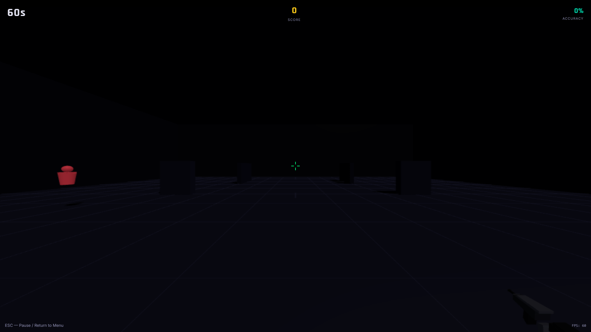
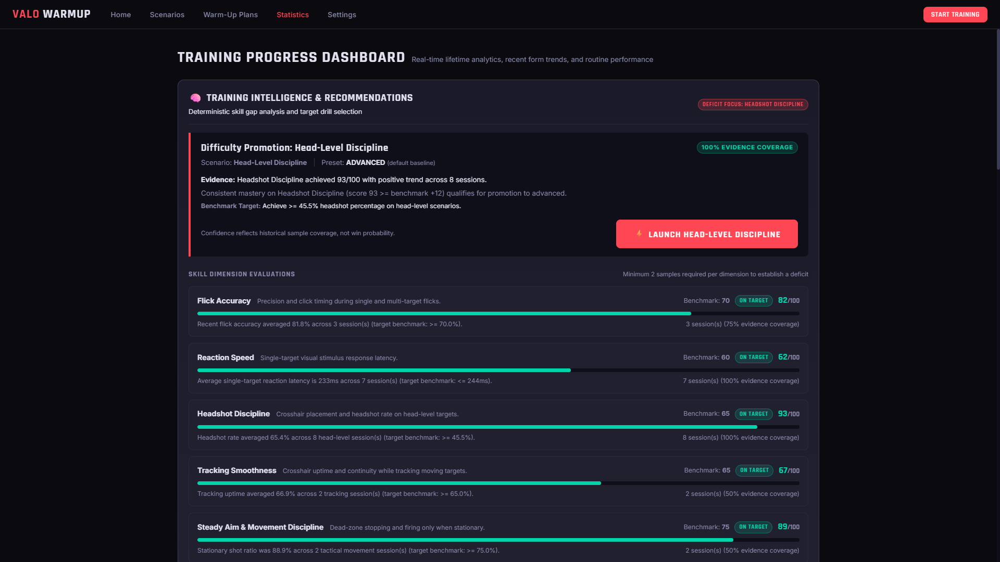
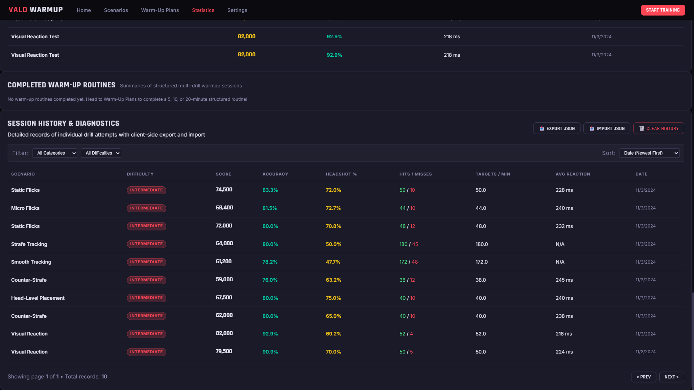

# WarmupLab

A lightweight, zero-install 3D tactical aim trainer built with TypeScript, WebGL (Three.js), and the Web Audio API.

Runs in the browser using relative mouse movement via the Pointer Lock API, velocity-based counter-strafing penalties, procedural weapon recoil, adaptive difficulty progression, and client-side session diagnostics.

[**Cloudflare Pages**](https://warmup-lab.pages.dev) &bull; [**GitHub Pages**](https://abdallahmazouz.github.io/Warmup-Lab-Trainer/) &bull; [Screenshots](#screenshots) &bull; [Quick Start](#quick-start) &bull; [Scenarios](#training-scenarios--routines) &bull; [Progression System](#adaptive-difficulty-engine) &bull; [Architecture](#architecture)

---

## Screenshots

### 3D Training Arena

*Tactical arena drill featuring the 3D Vandal rifle model, head and torso target hitboxes, centered crosshair, and real-time performance HUD.*

### Training Intelligence & Adaptive Progression

*Diagnostic evaluation across five core skill dimensions with automated deficit detection, benchmark comparison, and drill recommendations.*

### Session History & Diagnostics

*Paginated drill session records with category and difficulty filtering, sort controls, and client-side JSON export and import capabilities.*

> [!NOTE]
> Performance metrics shown in the Training Intelligence and Session History screenshots reflect synthetic demonstration data generated for documentation purposes, not genuine player results.

---

## Highlights

- **Movement Inaccuracy & Counter-Strafing**: Bullet spread penalty applies when moving above the 0.6 m/s dead-zone threshold. Accurate shots require decelerating to a stop or counter-strafing with opposite movement keys.
- **Procedural Ballistics & Viewmodel**: 3D Vandal rifle model with procedural recoil kick, rotational pitch recovery, weapon sway, and dynamic muzzle flash.
- **Synthesized Audio Engine**: Procedural sound generation via the Web Audio API without external audio files. Includes four weapon sound profiles (Vandal, Phantom, Operator, Classic) and ascending kill-confirmation audio cues.
- **Adaptive Difficulty Engine**: Evaluates completed sessions across five skill dimensions (Flick Accuracy, Reaction Speed, Headshot Discipline, Tracking Smoothness, Steady Aim & Movement Discipline) across Beginner, Intermediate, Advanced, and Pro tiers, recommending Focus Drills or Consolidation routines when needed.
- **Session History & Diagnostics**: Stores up to 100 sessions in browser local storage with paginated review, performance metrics, and atomic JSON export/import with duplicate detection and schema validation.
- **Render-Gated Performance**: Pauses WebGL rendering during menu screens to reduce idle CPU/GPU usage, reuses normalized unit geometries with dynamic scaling, and samples pre-generated noise buffer pools for gunshot synthesis.
- **Local-First Storage**: Settings, personal best records, and session history are stored locally in the browser's `localStorage` (unencrypted, client-side only). No accounts, telemetry, or remote servers are used.

---

## Training Scenarios & Routines

### Scenario Catalog

The 22 scenarios in the registry are organized across six internal categories (`flick`, `tracking`, `tactical`, `flash`, `reaction`, `hybrid`). The table below outlines them within their corresponding functional training groupings:

| Training Group (Registry Category) | Scenario | Objective |
|---|---|---|
| **Flicks** (`flick`) | Static Flicks | Clean single-target flick practice. Targets respawn at random positions upon elimination. |
| | Micro Flicks | Tiny targets clustered near crosshair. Practice micro-adjustments and crosshair fine-tuning. |
| | Wide Flicks | Large angular displacement flicks. Reset crosshair after wide swings. |
| | Multi-Target Flicks | Three static targets on screen simultaneously. Prioritize and eliminate in rapid succession. |
| | Precision Flicks | Small targets with heavy penalties for missed shots. Rewards patient, pinpoint accuracy. |
| | Reactive Flicks | Targets have a strict time window before expiring. Tests flick speed under time pressure. |
| **Tracking** (`tracking`) | Smooth Tracking | Maintain your crosshair continuously on a smoothly moving wandering target. |
| | Reactive Tracking | Target changes direction unpredictably. Train your reflexes to track erratic movements. |
| | Strafing Target Tracking | Target strafes horizontally mimicking an ADAD duel. Keep crosshair locked through direction shifts. |
| | Vertical Tracking | Target oscillates vertically simulating elevation changes and vertical mobility. |
| **Tactical Duels** (`tactical`) | Wide Swing Duel | Simulates enemies wide-swinging from corners. Snap onto full-speed swinging opponents. |
| | Jiggle Peek Punishment | Opponents briefly shoulder/jiggle peek from cover. Click during the short exposure window. |
| | Angle Clearing | Clear common map corner angles with strict head-level discipline. Tests methodical crosshair slicing. |
| | Counter-Strafe Practice | Move using A and D. Stop completely (counter-strafe) before clicking. Shots while moving are penalized. |
| | Head-Level Discipline | Strict head-level crosshair training. Only upper hits count as headshots; torso hits yield minimal points. |
| | First-Shot Discipline | Every shot matters. High rewards for 1-tap kills, heavy point deduction for spamming shots. |
| **Tactical & Flash** (`flash`) | Pop Flash Reaction & Duel | Pop flashes ignite randomly. Turn camera away or recover and eliminate the appearing duel threat. |
| | Delayed Flash & Switch | A flash detonates followed immediately by two flanking targets. Turn, recover vision, and eliminate both. |
| **Speed & Reaction** (`reaction`) | Visual Reaction Test | Target spawns at random intervals directly in center field. Click as fast as humanly possible. |
| | Peripheral Target Detection | Targets spawn in extreme peripheral vision angles. Tests radar awareness and fast reorientation. |
| **Hybrid** (`hybrid`) | Tactical Combo Warmup | Comprehensive routine combining flicks, tracking, counter-strafing, and wide-swing duels. |
| | Clutch Elimination 1v3 | Multiple dynamic threats closing in. Survive and eliminate all 3 targets under pressure. |

### Structured Routines

- **5-Minute Quick Warm-Up**: Wrist activation, head-level alignment, and static flicking before competitive matches.
- **10-Minute Standard Routine**: Balanced routine covering flicks, micro-adjustments, strafe tracking, jiggle peeks, and counter-strafing.
- **20-Minute Pro Conditioning**: Extended routine combining precision micro-flicks, reactive tracking, flash avoidance, and high-pressure clutch scenarios.

---

## Adaptive Difficulty Engine

The diagnostic system evaluates completed sessions across five core skill dimensions:

1. **Flick Accuracy**: Target acquisition accuracy and click timing on single and multi-target flick geometries.
2. **Reaction Speed**: Single-stimulus visual reaction latency on eligible targets.
3. **Headshot Discipline**: Crosshair placement and headshot ratio on head-level target geometries.
4. **Tracking Smoothness**: Crosshair continuous uptime percentage while tracking moving targets.
5. **Steady Aim & Movement Discipline**: Stationary shot ratio verifying complete dead-zone stop before firing.

### Tier Progression & Gating

The engine uses four difficulty tiers: **Beginner**, **Intermediate** (baseline), **Advanced**, and **Pro**. Tiers apply calibrated multipliers to target radius, movement velocity, and exposure lifetime.

Promotion requires satisfying all of the following validation gates:
- Minimum of 3 eligible sessions at the current difficulty tier.
- Evaluation confidence score $\ge 0.75$.
- Primary dimension score exceeding the tier benchmark by at least $+12$ points.
- Stable performance trend without recent regression.
- Minimum throughput (shots per session) and tracking uptime guards.
- Absence of critical deficits in other tested dimensions.

### Diagnostic Recommendations

- **Focus Drills**: Prescribed when an isolated deficit occurs in a single dimension, targeting mechanical weaknesses at the current tier.
- **Consolidation Routines**: Prescribed when systemic deficits span multiple dimensions or when excessive shooting occurs while moving (aggregate moving-shot ratio $> 35\%$). Clamps difficulty to baseline and recommends structured routine reinforcement.

---

## Controls

| Action | Control | Notes |
|---|---|---|
| **Aim / Look** | Mouse | Relative delta movement via the browser Pointer Lock API |
| **Fire** | Left Mouse Button | Triggers procedural recoil, spread penalty, and muzzle flash |
| **Movement** | `W`, `A`, `S`, `D` | Velocity-based movement physics |
| **Jump** | `Space` | Elevation adjustment |
| **Pause / Release Mouse** | `ESC` | Pauses simulation and unlocks cursor |
| **Toggle Fullscreen** | `F11` | Native browser full-screen shortcut |

### Sensitivity & Crosshair Customization

- **Sensitivity Calibration**: Uses Valorant's standard $0.07^\circ$ per count angular yaw scaling factor (`(sensitivity * 0.07) * (π / 180)`).
- **Field of View (FOV)**: Configurable horizontal FOV from 70° to 120° (defaults to 103°).
- **Interactive Crosshair Customizer**: Live real-time preview supporting inner lines, center dot, thickness, length, gap, opacity, and color presets (Cyan, Green, Yellow, Red, White).

---

## Audio Engine

Sound effects are synthesized procedurally at runtime using the Web Audio API without external audio files:

- **Weapon Profiles**:
  - `Vandal`: Sharp crack with rapid decay.
  - `Phantom`: Muffled, low-frequency sound with low-pass filtering.
  - `Operator`: Heavy resonant shot with sustained bass.
  - `Classic`: Crisp, light transient pop.
- **Hit Feedback**: Separate body impact click and headshot bell resonance.
- **Killstreak Audio**: Five ascending harmonic kill-confirmation stages (stages 1 through 5+) that escalate with consecutive kills within a drill session.
- **Noise Buffer Cache**: Pre-generated procedural noise pools reduce runtime allocations during sustained fire.

---

## Architecture

The project consists of 16 TypeScript source files and 1 stylesheet in `src/`, 12 test suites in `tests/`, and documentation assets in `docs/assets/`:

```
warmup-lab/
├── index.html                               # HTML entry point, canvas element, embedded SVG favicon
├── package.json                             # Dependencies and build/test scripts
├── tsconfig.json                            # TypeScript configuration (target ES2022)
├── vite.config.ts                           # Vite configuration with chunk splitting & jsdom test config
├── .github/
│   └── workflows/
│       └── deploy.yml                       # Automated CI/CD pipeline for GitHub Pages
├── docs/
│   └── assets/
│       ├── arena-gameplay.png               # 3D training arena screenshot
│       ├── training-intelligence.png        # Adaptive progression interface screenshot
│       └── session-history.png              # Session diagnostics interface screenshot
├── src/
│   ├── main.ts                              # Application bootstrap and core event wiring
│   ├── constants.ts                         # Arena dimensions, weapon parameters, physics constants
│   ├── types.ts                             # TypeScript domain models, interfaces, and schemas
│   ├── engine.ts                            # Simulation loop, timer orchestration, render gating
│   ├── renderer.ts                          # Three.js WebGL scene, lighting, shared unit geometries
│   ├── controls.ts                          # Pointer lock camera and velocity-based movement
│   ├── vandal.ts                            # Procedural 3D weapon viewmodel, recoil, and muzzle flash
│   ├── targetManager.ts                     # Target spawning, movement paths, head/torso raycasting
│   ├── scenarios.ts                         # Scenario catalog, routine playlists, difficulty presets
│   ├── recommendations.ts                   # Adaptive progression engine, gating, and deficit analysis
│   ├── analytics.ts                         # Performance aggregation, dimension scoring, trend calculation
│   ├── audio.ts                             # Procedural Web Audio synthesizer, noise cache, killstreaks
│   ├── soundProfiles.ts                     # Acoustic frequency parameters for weapon profiles
│   ├── settings.ts                          # User configuration storage and sensitivity conversion
│   ├── store.ts                             # History management, atomic JSON import/export, deduplication
│   ├── ui.ts                                # Accessible UI management, pagination, modal focus trapping
│   └── style.css                            # Responsive interface styling and table scroll cues
└── tests/
    ├── analytics.test.ts                    # Metric computation, trends, and history caps
    ├── auditEdgeCases.test.ts               # Raycasting math, tangent hits, vertical ray guards
    ├── competitivePolish.test.ts            # HUD timing, countdown orchestration, score formulas
    ├── game.test.ts                         # Core scenario registry and catalog validation
    ├── routineOrchestration.test.ts         # Routine transitions, playlist queues, timer resets
    ├── soundProfilesAndKillStreaks.test.ts  # Web Audio profiles, streak resets, mute states
    ├── targetHitDetection.test.ts           # Head/torso hitboxes and geometry lifecycle
    ├── targetMovement.test.ts               # Strafe, wander, jiggle peek, and boundary math
    ├── timingAndDashboard.test.ts           # UI pagination, modal focus trap, render gating
    ├── trainingIntelligenceCore.test.ts     # Adaptive progression, gating rules, consolidation
    ├── trainingIntelligenceUI.test.ts       # Focus drill launches and recommendation UI
    └── vandal.test.ts                       # Viewmodel recoil math, sway, and muzzle flash timing
```

---

## Quick Start

### Prerequisites
- [Node.js](https://nodejs.org/) (v18 or higher)
- `npm`

### Local Setup

```bash
# Clone the repository
git clone https://github.com/AbdallahMazouz/Warmup-Lab-Trainer.git
cd Warmup-Lab-Trainer

# Install dependencies
npm install

# Start development server
npm run dev
```

Open `http://localhost:5173/` in your browser.

### Test Suite

Run the full Vitest suite (247 unit and integration tests across 12 test files):

```bash
npm run test
```

### Production Build

Compile TypeScript and bundle production assets with Vite:

```bash
npm run build
```

Production output is generated in `dist/` with Three.js separated into an isolated vendor chunk (`three-vendor`) and relative asset paths (`./assets/...`) compatible with root and subpath hosting.

To preview the production bundle locally:

```bash
npm run preview
```

---

## Deployment

The repository includes an automated GitHub Actions workflow ([deploy.yml](.github/workflows/deploy.yml)) configured to run on pushes to `main`. It validates TypeScript types, executes all 247 Vitest tests, builds the production bundle, and deploys to GitHub Pages:

`https://abdallahmazouz.github.io/Warmup-Lab-Trainer/`

Additionally, because the production bundle uses relative base paths (`./`) and requires no server runtime or environment variables, the contents of `dist/` can be directly hosted on Cloudflare Pages (`https://warmup-lab.pages.dev`), Netlify, Vercel, or any standard static web server.

---

## Technical Disclaimer

WarmupLab is an independent, standalone web application. It runs in the browser using WebGL and standard web APIs. It does not interact with, inject into, read memory from, or modify VALORANT or any Riot Games software.

---

## License

[MIT License](LICENSE) © 2026 Abdallah Mazouz.
